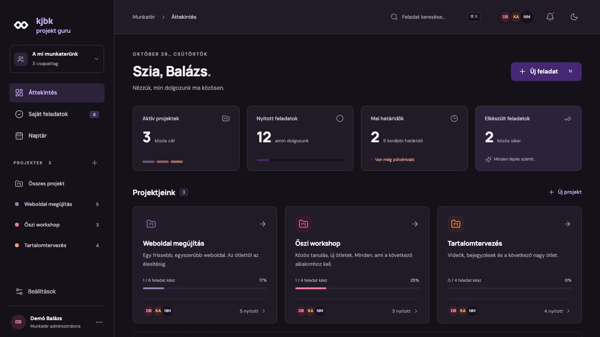
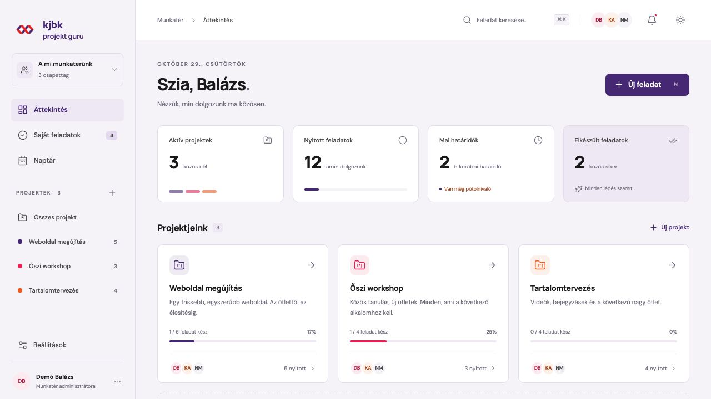

# kjbk projekt guru

Magyar nyelvű, saját szerveren futtatható projektkezelő 3–5 fős csapatoknak. Közös projektek, feladatok, határidők és naptár, asztalon és telefonon. React + TypeScript felület, Django backend, OAuth-hitelesítésű MCP-kapcsolat.

**Self-hosted Hungarian project management for small teams**, with shared projects, task boards, calendar integration, notifications and an OAuth-enabled MCP server for AI clients. The interface and documentation are currently in Hungarian.



<details>
<summary>Világos megjelenés</summary>



</details>

## Funkciók

- Egyetlen közös munkatér, legfeljebb 5 aktív taggal; meghívásos e-mail/jelszó belépés.
- Adminisztrátorként javítható csapattag-e-mail és belépési cím, a meglévő fiók és feladatai megtartásával.
- Projektáttekintő, Kanban, lista, havi csapatnaptár és mobilos napi lista.
- Feladatok felelőssel, prioritással, címkékkel, dátumos vagy pontos határidővel; részfeladatok, hozzászólások és legfeljebb 25 MB-os csatolmányok.
- Személyes Google Naptár-kapcsolat: a felhasználó a saját naptárába teheti a feladat határidejét. OAuth nélkül előre kitöltött Google-esemény és `.ics` letöltés is elérhető.
- Alkalmazáson belüli, e-mailes és Web Push értesítések. Öt eseménytípus, személyenként külön e-mail- és push-beállításokkal.
- Világos, sötét és rendszer szerinti megjelenés, fiókonként mentve.
- Távoli MCP-kiszolgáló ChatGPT/Claude és más kompatibilis kliensek számára, OAuth + PKCE hitelesítéssel és visszavonható kapcsolatokkal. Nincs beépített chat és nem kell OpenAI/Anthropic API-kulcs.
- Verzióellenőrzés a párhuzamos feladatszerkesztés ütközéseinek jelzésére.

Minden aktív csapattag látja és szerkesztheti a közös projekteket. Ez kis, egymásban megbízó csapatoknak készült; nincs projektenkénti hozzáférési szint.

## Helyi kipróbálás

Python 3.12 és Node.js 22 szükséges. A helyi változat SQLite-ot használ; Dockerrel PostgreSQL, natív telepítéshez MariaDB is használható.

```sh
git clone https://github.com/kobak/kjbk-projekt-guru.git
cd kjbk-projekt-guru
python3.12 -m venv .venv
.venv/bin/python -m pip install -r requirements.lock
.venv/bin/python scripts/configure.py --local
.venv/bin/python manage.py migrate
npm --prefix frontend ci
npm --prefix frontend run build
.venv/bin/python manage.py seed_demo
.venv/bin/python manage.py runserver 127.0.0.1:8000
```

Nyisd meg a **http://localhost:8000** címet. Helyi demóbelépés: `demo@kozos.local` / `Kozos-demo-2026!`. A `seed_demo` kizárólag üres, `DEBUG=true` fejlesztői adatbázison fut; éles rendszerhez ne használd.

Az értesítési és naptárszinkron-folyamat második terminálból indítható:

```sh
.venv/bin/python manage.py runworker
```

Demó helyett saját helyi adminhoz hagyd ki a `seed_demo` lépést, és futtasd a `.venv/bin/python manage.py setup_workspace` parancsot. A jelszót interaktívan kéri.

## Telepítés és használat

| Leírás | Tartalom |
| --- | --- |
| [Telepítés](docs/deployment.md) | Docker/PostgreSQL és natív Ubuntu/MariaDB, HTTPS, első admin, frissítés |
| [Integrációk](docs/integrations.md) | Google Naptár, SMTP/Brevo, push, MCP, témaválasztás |
| [Mentés és visszaállítás](docs/backup-and-restore.md) | Adatbázis, csatolmányok, kulcsok és a hozzájuk illő forrásverzió |
| [Felépítés](docs/architecture.md) | Könyvtárak, adatmodell, háttérfolyamat, jogosultságok |
| [Közreműködés](CONTRIBUTING.md) | Fejlesztés, tesztelés, hibajelentés |
| [Biztonsági hibák](SECURITY.md) | Nem nyilvános hibajelentés és üzemeltetési határok |
| [Arculati feltételek](BRANDING.md) | A KJBK-logók cseréje saját telepítésnél |
| [Változásnapló](CHANGELOG.md) | Kiadások és ismert korlátok |

Az alkalmazás, az adatbázis és a worker technikai neve a fájlokban továbbra is `kozos`. Ez szándékos: a meglévő telepítések útvonalait, adatbázisait és volume-jait megőrzi.

## Ellenőrzések

```sh
.venv/bin/python manage.py check
.venv/bin/python manage.py makemigrations --check --dry-run
.venv/bin/python manage.py test core --noinput
npm --prefix frontend run build
```

A backendteszt-csomag 84 ellenőrzést tartalmaz, köztük az adminisztrátori e-mail-javítás jogosultság-, belépési és címzési próbáit. A GitHub Actions a tiszta telepítést, frontend-buildet, SQLite/PostgreSQL/MariaDB teszteket és a Docker-buildet ellenőrzi. A külső Google-, SMTP- és push-küldést a tesztek helyettesítik; tesztfutás közben valódi címzettnek nem küldenek üzenetet.

Az asztali és 390 px széles mobilnézet böngészős próbán is átesett. A `theme-init.js` szinkron betöltése miatti Vite-figyelmeztetés szándékos: ez alkalmazza a választott témát az első kirajzolás előtt; a fájl a buildben is szerepel.

## Jelenlegi határok

- Egy közös munkatér, legfeljebb 5 aktív tag; nincs egyéni projekt vagy ismétlődő feladat.
- Asana-, Notion- és Trello-import még nincs megvalósítva.
- Jelenleg e-mail/jelszó belépés van; Google-belépés nincs. A Google OAuth-kapcsolat a naptárhoz tartozik.
- A Google-szinkron egyirányú: a feladat a forrás, a naptárban szerkesztett esemény nem ír vissza a feladatra. Minden telepítéshez saját OAuth-kliens kell.
- A PWA használatához internet szükséges; nincs offline feladatgyorsítótár. A pushhoz HTTPS, támogatott böngésző és eszközengedély kell.
- Webes, távoli MCP-kliensek az elsődlegesek. A natív CLI-kliensek localhost HTTP callbackje éles módban további átirányítási szabályt igényel.
- Ez nem teljes körű vállalati Asana/Notion-helyettesítő, és nem több ügyfél elkülönített kiszolgálására készült.

## Licenc

A saját forráskód [MIT-licencű](LICENSE). A külső függőségek saját licenceik alatt érhetők el; a Lucide ikonok ISC-licencét a [THIRD_PARTY_NOTICES.md](THIRD_PARTY_NOTICES.md) tartalmazza. A KJBK Infinity neve és logói külön arculati anyagok: **saját telepítéshez és továbbadott változathoz cseréld le őket** a [BRANDING.md](BRANDING.md) szerint. A logókra az MIT-engedély nem terjed ki.

A repó forráskód-mentés. Éles adatbázis, csatolmány, `.env`, SMTP-kulcs és felhasználói adat nem része a repónak vagy a kiadásoknak. Teljes helyreállításhoz a [külön adatmentés](docs/backup-and-restore.md) is szükséges.
