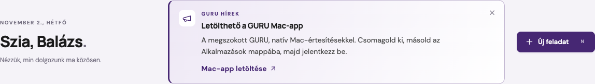

# Hírek a kezdőlapon

A hírsáv rövid, feladattól független információt jelenít meg a csapatnak. Asztalon a köszöntés és az **Új feladat** gomb közötti teret használja; kisebb képernyőn alájuk kerül. Weben és a Mac-appban is ugyanaz a hír jelenik meg. A Mac-app újratelepítése nem szükséges: a szerver frissítése után a Frissítés gomb betölti az új felületet.

## Adminisztráció

**Beállítások → Hírek**, vagy közvetlenül `/?settings=news`. A fül és a kezelési végpontok kizárólag adminisztrátoroknak érhetők el.

1. Az **Új hír** gombbal üres szerkesztő nyílik.
2. Adj meg címet és rövid szöveget. Opcionális linkgombhoz felirat és cím is szükséges.
3. Az élő **Előnézet** mutatja a kártyát. A **Mentés** vázlatot készít; ezt még nem látja a csapat.
4. Az elmentett hír **Közzététel** gombja jeleníti meg a kezdőlapon. Egyszerre egy hír lehet közzétéve; az új közzététele leveszi a korábbit.
5. A **Szerkesztés** újra megnyitja a tartalmat. A **Levétel** eltünteti a hírsávot, de a hír megmarad az admin listájában és később újra közzétehető.

A közzétett hír mentett tartalmi változtatása ismét megjelenik azoknak is, akik a korábbi változatot elrejtették. A változatlan tartalom mentése ezt nem teszi meg. A levétel és újraközzététel is új változatnak számít. Párhuzamos szerkesztésnél a korábbi változat nem írhatja felül az újabbat; ilyenkor a szerkesztőt újra kell tölteni.

A cím legfeljebb 120, a szöveg 500, a gombfelirat 50 karakter. A tartalom egyszerű szöveg, HTML és beágyazott kód nélkül. A link HTTPS-cím vagy `/` jellel kezdődő belső útvonal lehet, például `/?task=<feladatazonosító>`; a `javascript:`, `data:`, protokoll nélküli külső cím és URL-be írt felhasználónév/jelszó nem megengedett.

## Személyes elrejtés

A kártya jobb felső sarkában levő **×** csak a bejelentkezett felhasználónak rejti el az adott hírverziót. A választás a fiókhoz tartozik, így másik böngészőben és a Mac-appban is érvényes. Más csapattagok továbbra is látják. Az új vagy módosított hír ismét megjelenik.

A hírek nem hoznak létre feladatot, és nem küldenek automatikus e-mailt vagy push-értesítést.

## Üzemeltetés és felépítés

- `0008_announcements` migráció: hírek és fiókonkénti, verzióhoz kötött elrejtések.
- Az egyetlen aktív helyet adatbázisszintű, nullable UNIQUE mező védi SQLite, PostgreSQL és MariaDB alatt. A publikálás a munkatér zárolásával történik.
- Az `/api/bootstrap/` csak az aktuális felhasználónak látható hírt adja vissza. Vázlat vagy elrejtett változat nem kerül bele.
- Admin: `GET/POST /api/announcements/`, `PATCH /api/announcements/<id>/`, `POST …/publish/`, `POST …/unpublish/`.
- Bejelentkezett tag: `POST /api/announcements/<id>/dismiss/`, a megjelenített `version` értékével. A címzett a bejelentkezésből származik, nem a kérésben megadott felhasználóazonosítóból.
- Minden módosításhoz CSRF-védelem és megfelelő jogosultság szükséges; a válaszok nem gyorsítótárazhatók.
- Az adatok a rendes adatbázismentésben szerepelnek. A migráció a korábbi feladatokat, csatolmányokat és beállításokat nem módosítja.
